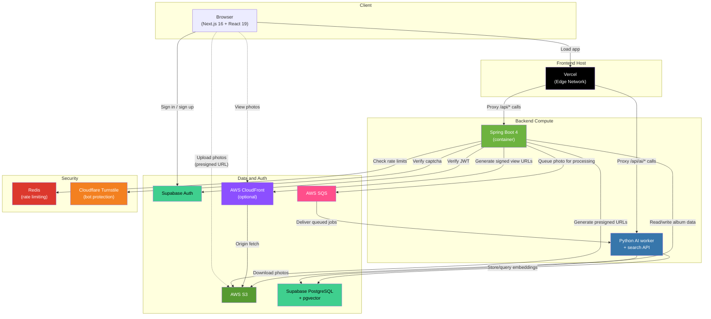
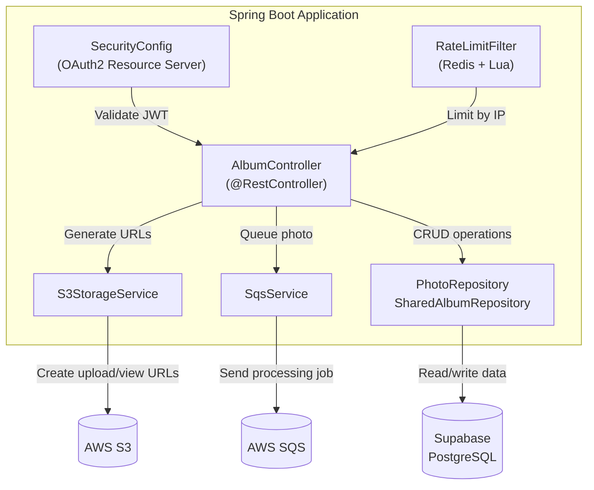
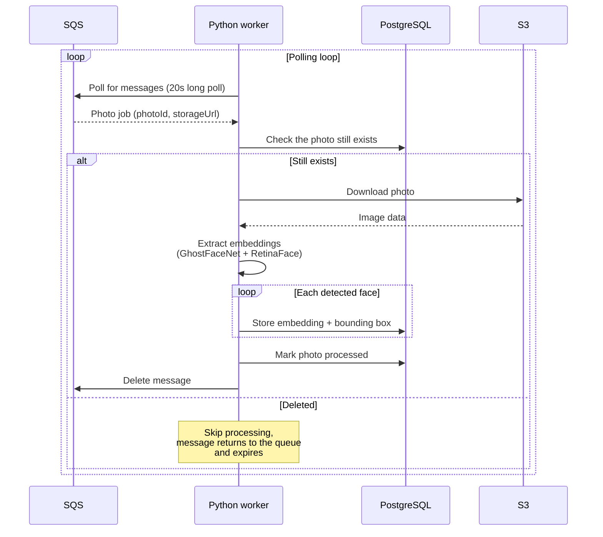
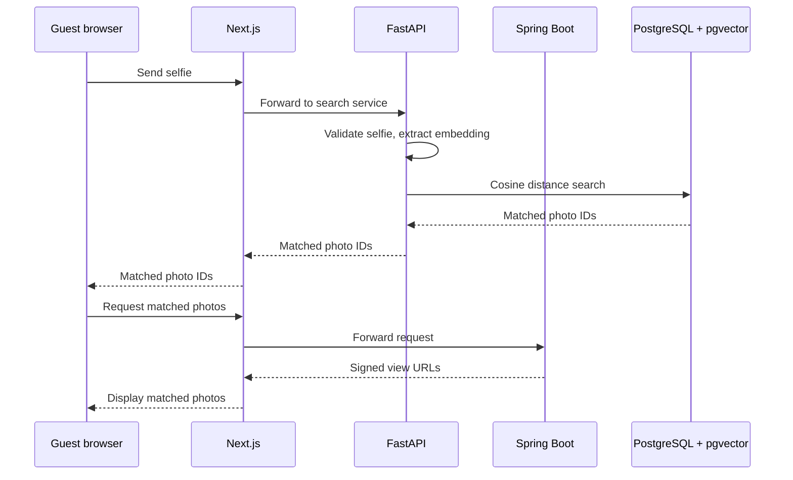
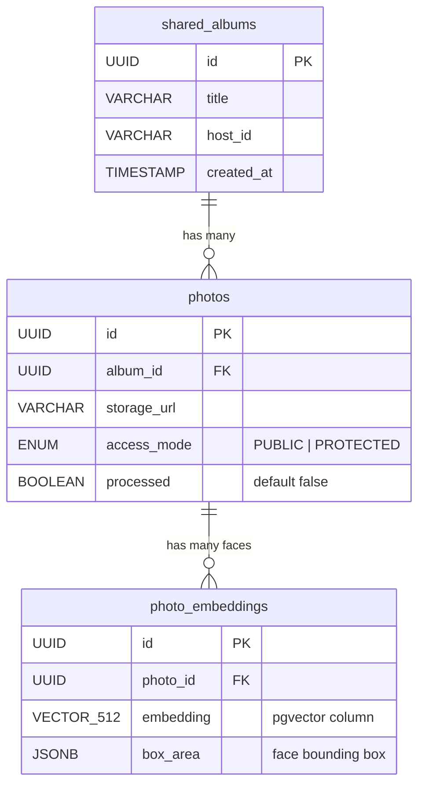
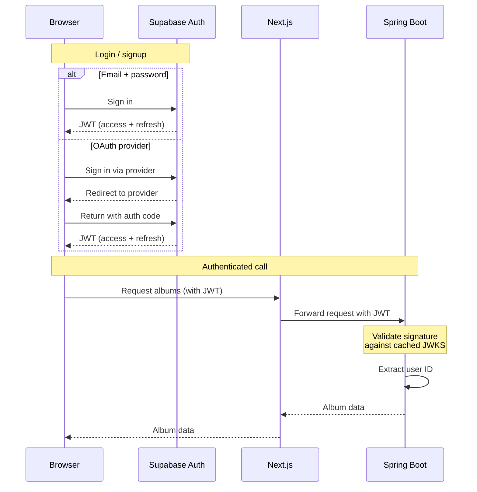
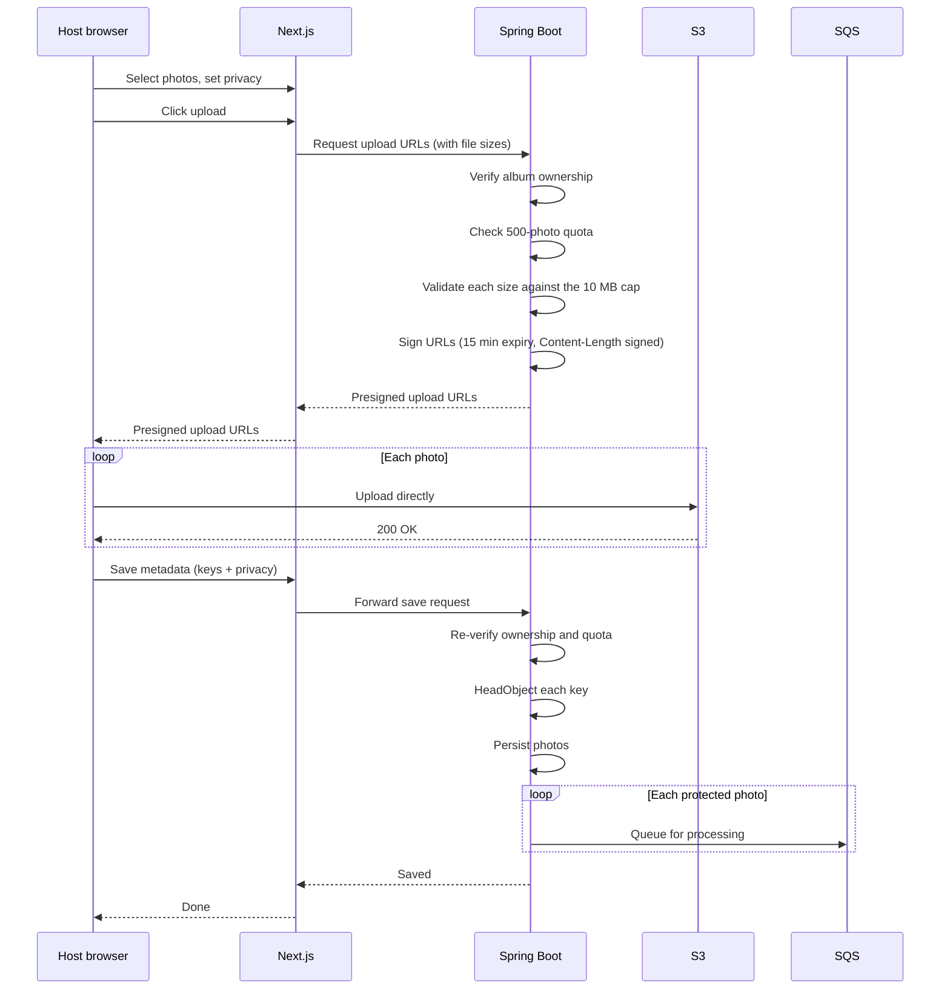

# GrabPic

Photo sharing for events, with face search. A host uploads every photo from the event into one album and shares a single link. Guests open the link, take a selfie, and get back only the photos they appear in.

Live at [grab-pic.vercel.app](https://grab-pic.vercel.app/).

https://github.com/user-attachments/assets/67c5376e-39d9-4dd9-8229-2897f79ab3db


## Contents

- [What it does](#what-it-does)
- [Architecture](#architecture)
- [Stack](#stack)
- [Services](#services)
- [Database](#database)
- [Authentication](#authentication)
- [Upload pipeline](#upload-pipeline)
- [Guest search](#guest-search)
- [API reference](#api-reference)
- [Security](#security)
- [Deployment](#deployment)
- [Project layout](#project-layout)
- [Running it locally](#running-it-locally)
- [Environment variables](#environment-variables)

## What it does

After an event the photos sit with whoever took them, and everyone else spends the next week asking for the ones they are in. GrabPic replaces that with a link.

The host creates an album, uploads photos, and marks each one public or protected. Protected is the default and means the photo is only shown to people whose face is in it. Public photos are visible to anyone holding the album link, which is what you want for venue shots and wide crowd shots. Either way the photo gets queued for face processing, so selfie search covers the whole album.

A background worker finds the faces in each photo and stores one 512-dimension embedding per face. When a guest submits a selfie, the search service embeds it the same way and runs a cosine-distance lookup against that album's embeddings. Matches come back as photo IDs, the API turns those into signed view URLs, and the guest can download the set as a zip. Guests never create an account and nobody tags anyone by hand.

Free up to 500 photos per user across all albums, no watermarks. It works for whatever you point a camera at: weddings, conferences, graduations, birthdays, festivals.

## Architecture



Three services, deployed independently. They talk to each other through an SQS queue for async work and share a Postgres database and an S3 bucket. Photo viewing goes through CloudFront signed URLs when a distribution is configured and falls back to S3 presigned URLs when it is not. Rate limiting is backed by Redis; the endpoints bots would care about sit behind Cloudflare Turnstile.

The browser never calls a backend service directly. Next.js rewrites proxy everything, which keeps the backend URLs out of the client bundle and sidesteps CORS.

## Stack

### Frontend

| Technology       | Version | Purpose                                                     |
| ---------------- | ------- | ----------------------------------------------------------- |
| Next.js          | 16.1.6  | App Router, SSR, API proxying                               |
| React            | 19.2.3  | UI rendering                                                |
| TypeScript       | 5.x     | Type safety                                                 |
| Tailwind CSS     | 4.x     | Styling, dark mode                                          |
| Supabase JS      | 2.97.0  | Client auth (OAuth, email/password), realtime subscriptions |
| JSZip            | 3.10.1  | Client-side zip generation for bulk downloads               |
| qrcode.react     | 4.2.0   | QR codes for album sharing                                  |
| Lucide React     | 0.575.0 | Icons                                                       |
| Radix UI         | 1.4.3   | Accessible UI primitives                                    |
| Vercel Analytics | 1.6.1   | Usage tracking                                              |

### Backend API

| Technology         | Version    | Purpose                                        |
| ------------------ | ---------- | ---------------------------------------------- |
| Spring Boot        | 4.0.3      | REST API                                       |
| Java               | 21         | Language runtime (LTS)                         |
| Spring Security    | (via Boot) | OAuth2 resource server, JWT validation         |
| Spring Data JPA    | (via Boot) | Repository layer                               |
| Hibernate          | (via JPA)  | Database mapping, DDL validation               |
| PostgreSQL driver  | (runtime)  | JDBC connectivity                              |
| AWS SDK S3         | 2.20.0     | Presigned URLs for uploads and views           |
| AWS SDK SQS        | 2.20.0     | Job queue messaging                            |
| AWS SDK CloudFront | 2.20.0     | Signed CDN URLs                                |
| Spring Data Redis  | (via Boot) | Rate limit counters                            |
| Lombok             | (compile)  | Boilerplate reduction                          |
| Maven              | 3.9.6      | Build                                          |

### Face recognition

| Technology   | Version        | Purpose                                       |
| ------------ | -------------- | --------------------------------------------- |
| Python       | 3.x            | Language runtime                              |
| DeepFace     | 0.0.98         | Face detection and embedding extraction       |
| GhostFaceNet | (via DeepFace) | Recognition model, 512-D embeddings           |
| RetinaFace   | 0.0.17         | Detection backend                             |
| TensorFlow   | 2.20.0         | Inference runtime                             |
| FastAPI      | 0.132.0        | HTTP API for guest selfie search              |
| Uvicorn      | 0.41.0         | ASGI server                                   |
| Boto3        | 1.42.55        | S3 and SQS client                             |
| psycopg2     | 2.9.11         | Postgres connectivity, pooled                 |
| Pillow       | (latest)       | Image validation, decompression bomb checks   |
| SlowAPI      | 0.1.9          | Rate limiting on the search endpoint          |
| OpenCV       | 4.13.0         | Image processing                              |
| NumPy        | 2.2.6          | Numerical work                                |
| Gunicorn     | 25.1.0         | WSGI server                                   |

### Infrastructure

| Service               | Provider   | Purpose                                          |
| --------------------- | ---------- | ------------------------------------------------ |
| Vercel                | Vercel     | Frontend hosting                                 |
| S3                    | AWS        | Photo storage                                    |
| SQS                   | AWS        | Queue between upload and face processing         |
| CloudFront            | AWS        | Optional CDN for photo viewing with signed URLs  |
| PostgreSQL + pgvector | Supabase   | Relational data and vector search                |
| Supabase Auth         | Supabase   | Google, GitHub, and email/password sign-in       |
| Redis                 | (any)      | Token bucket rate limiting                       |
| Turnstile             | Cloudflare | Bot protection on expensive endpoints            |
| Docker                | -          | Container images for the API and Python services |

## Services

### Frontend

Next.js 16 App Router with React 19, deployed on Vercel. All API calls go through rewrites defined in `next.config.ts`: `/api/*` reaches Spring Boot, `/api/ai/*` reaches FastAPI.

| Route                         | Auth                     | What it is                                                        |
| ----------------------------- | ------------------------ | ----------------------------------------------------------------- |
| `/`                           | No                       | Landing page                                                      |
| `/login`                      | No (redirects if authed) | Email/password plus Google and GitHub OAuth                       |
| `/signup`                     | No (redirects if authed) | Registration with email verification                              |
| `/dashboard`                  | Yes                      | Album list, album creation                                        |
| `/dashboard/albums/[id]`      | Yes                      | Upload page with drag-and-drop and privacy toggles                |
| `/dashboard/albums/[id]/view` | Yes                      | Album viewer with face overlays, share modal, QR code, bulk download |
| `/albums/[id]/guest`          | No                       | Guest page with selfie camera, face search, zip download          |

`useRequireAuth()` checks the Supabase session and bounces unauthenticated users to `/login`. `useRedirectIfAuth()` does the reverse on the login and signup pages.

Photos load straight from CloudFront or from S3 presigned URLs. The bucket's CORS rules are applied at API startup to allow `GET` and `PUT` from the frontend origin, so there is no server-side image proxy in the hot path.

When the worker flips a photo's `processed` flag, the album view picks that up over a Supabase Realtime subscription and refreshes on its own.

### Backend API

Spring Boot 4 handles album CRUD, photo metadata, presigned URL generation, and SQS dispatch. It runs as a Docker container.



Every request except the guest endpoints is validated against Supabase's JWKS endpoint using ES256 signed JWTs. The filter chain permits `/api/albums/*/guest/**` and requires a valid token for everything else. CORS allows the frontend origin only.

Rate limiting is a Redis token bucket driven by an atomic Lua script, with three buckets per client IP:

| Endpoint pattern         | Limit       | Window   |
| ------------------------ | ----------- | -------- |
| `/guest/search-results`  | 5 requests  | 1 minute |
| `/guest/details`         | 20 requests | 1 minute |
| `/api/*` (authenticated) | 60 requests | 1 minute |

Client IPs come from `request.getRemoteAddr()` with Tomcat's `RemoteIpValve` enabled (`server.forward-headers-strategy=NATIVE`), so `X-Forwarded-For` cannot be spoofed. If Redis is down the limiter fails open rather than blocking every request.

`RateLimitFilter` also sets `X-Content-Type-Options: nosniff`, `X-Frame-Options: DENY`, `X-XSS-Protection: 1; mode=block`, `Referrer-Policy: strict-origin-when-cross-origin`, and `Permissions-Policy: camera=(), microphone=(), geolocation=()` on every response.

Two flows sit behind Cloudflare Turnstile. `POST /api/albums/{albumId}/upload-urls` needs a valid token in the `X-Turnstile-Token` header before any presigned URL is issued, and the guest selfie search sends its token to the FastAPI service, which verifies it before running DeepFace. Both verifications include the client IP and an optional hostname allowlist.

On startup `S3StorageService` applies a lifecycle rule that aborts incomplete multipart uploads after a day, and writes the bucket CORS configuration.

Photo view URLs are CloudFront signed URLs with a 7-hour expiry when `CLOUDFRONT_DOMAIN`, `CLOUDFRONT_KEY_PAIR_ID`, and `CLOUDFRONT_PRIVATE_KEY_STRING` are set. That cuts S3 egress and serves from an edge location. Without them the service falls back to S3 presigned URLs.

The 500-photo-per-user quota is checked twice, once when handing out presigned upload URLs and again when saving photo metadata, with a maximum of 50 URLs per request.

Upload size is enforced in three places:

1. The frontend rejects files over 10 MB before an upload starts.
2. The upload-urls endpoint takes file sizes in the request body and signs `Content-Length` into each presigned PUT, so S3 rejects anything that does not match.
3. Saving metadata calls `HeadObject` on each key to confirm the object exists and is within 10 MB.

`GlobalExceptionHandler` is a `@ControllerAdvice` that turns unhandled exceptions into JSON instead of Spring's HTML error pages. Stack traces go to the log, never to the client.

### Face worker

A long-running Python process that polls SQS for photos to process.



Long polling with a 20-second wait keeps empty receives down. Messages are deleted only after the work succeeds, so a crash mid-photo means the message becomes visible again and gets retried. Processing is at-least-once.

Before downloading anything the worker checks that the photo still exists, since a host may have deleted it between queueing and pickup.

DeepFace runs with GhostFaceNet as the model and RetinaFace as the detector. `enforce_detection` is off so a photo with no faces is simply marked processed with zero embeddings instead of raising. Each photo gets a 300-second `signal.alarm` so a corrupt image cannot hang the loop.

Pillow checks the pixel count against a 25-megapixel limit before DeepFace touches the image, which is roughly 75 MB of uncompressed RGB. That stops a small file from expanding into gigabytes of memory. Anything over the limit is marked processed with no embeddings.

Postgres connections come from a `psycopg2.pool.SimpleConnectionPool` (1 to 2 connections) rather than a fresh connection per message.

Each face produces a 512-float vector and a bounding box. The vector is formatted as a pgvector literal and inserted into `photo_embeddings`; the box goes into a JSONB column that the frontend uses to draw overlays.

### Search API

FastAPI, running alongside the worker, exposing `POST /search` for guest selfie matching. The frontend proxies `/api/ai/*` here.



Validation happens before any inference: the album ID has to match a UUID regex, the MIME type has to be JPEG, PNG, or WebP, the file has to be under 5 MB, and the magic bytes have to agree with the declared content type. Pillow applies the same 25-megapixel check as the worker.

The selfie is written to a temp file for DeepFace and deleted in a `finally` block whatever happens. It is never stored.

Matching uses pgvector's `<=>` cosine distance operator with a default threshold of 0.70 and a cap of 200 results. `FACE_SEARCH_HIGH_RECALL=true` loosens both (0.90 and 500), queries up to three faces from the selfie instead of one, and stops requiring a confident face detection on the selfie, which helps with awkward lighting and angles at the cost of more false positives.

An HNSW index on `photo_embeddings.embedding` (`m=16`, `ef_construction=64`) is created at startup if it does not exist, so searches use approximate nearest neighbours rather than a sequential scan.

Connections come from a `SimpleConnectionPool` of 1 to 3. SlowAPI limits the endpoint to 5 requests per minute per IP, reading the client address from `X-Forwarded-For` or `X-Real-IP`.

## Database

Supabase PostgreSQL with the pgvector extension.



`shared_albums.host_id` is the Supabase Auth user ID taken from the JWT `sub` claim. `created_at` is set by a `@PrePersist` callback.

`photos.storage_url` is the S3 object key, `albums/{albumId}/{uuid}.jpg`. `access_mode` is `PUBLIC` or `PROTECTED`, and `processed` tracks whether the worker has been through it.

`photo_embeddings` holds one row per detected face, so a photo of three people produces three rows. `box_area` is the bounding box (`x`, `y`, `w`, `h`) the frontend draws overlays from.

Deletes cascade at the JPA level (`CascadeType.ALL` with `orphanRemoval = true`): removing an album removes its photos, and removing a photo removes its embeddings.

One thing to know if you rebuild the database from scratch: `photos` needs `alter table public.photos replica identity full`. Without it, Realtime cannot evaluate the RLS policy on updates and silently delivers nothing, so the "scanning" badge never clears without a manual reload.

## Authentication



Supabase Auth handles sign-in for Google, GitHub, and email/password. Spring Security runs as an OAuth2 resource server, pulls public keys from Supabase's JWKS endpoint, and checks the ES256 signature on every request. The identity from `jwt.getSubject()` scopes every album query, so one user cannot read another's data.

Guest endpoints are exempted with `.requestMatchers("/api/albums/*/guest/**").permitAll()`.

## Upload pipeline



The browser uploads straight to S3, so file bytes never pass through the backend. Presigned PUTs expire after 15 minutes and are scoped to `content-type: image/jpeg`. Keys follow `albums/{albumId}/{randomUUID}.jpg`.

Protected photos go onto the queue at upload time. Public photos do not, since everyone can see them anyway, but flipping a public photo to protected later enqueues it as long as `processed` is still false.

## Guest search

On mobile the selfie comes from the native camera via `capture="user"`. On desktop a `getUserMedia()` stream feeds a canvas that produces a JPEG blob.

After matching, the guest sees the album's public photos alongside their own matches, can select individual photos or all of them, and downloads a zip built client-side with JSZip from the CloudFront or S3 URLs. When the selfie has no detectable face and strict detection is on, the API returns an error rather than an empty result, so the guest knows to retake it.

Guest responses deliberately omit face data (`faceCount=0`, empty `faceBoxes`), so bounding boxes are never exposed to unauthenticated callers.

## API reference

### Authenticated (JWT required)

| Method   | Endpoint                                                         | Description                                                 |
| -------- | ---------------------------------------------------------------- | ----------------------------------------------------------- |
| `POST`   | `/api/albums`                                                    | Create an album                                             |
| `GET`    | `/api/albums`                                                    | List the caller's albums                                    |
| `DELETE` | `/api/albums/{albumId}`                                          | Delete an album with its photos and embeddings              |
| `POST`   | `/api/albums/{albumId}/upload-urls`                              | Presigned S3 PUT URLs, max 50, file sizes in the body       |
| `POST`   | `/api/albums/{albumId}/photos`                                   | Save metadata after upload and queue for processing         |
| `POST`   | `/api/albums/{albumId}/photos/backfill-processing`               | Queue every unprocessed photo in the album                  |
| `GET`    | `/api/albums/{albumId}/photos`                                   | Album photos with signed view URLs                          |
| `DELETE` | `/api/albums/{albumId}/photos/{photoId}`                         | Delete one photo                                            |
| `PUT`    | `/api/albums/{albumId}/photos/{photoId}/privacy?makePublic=bool` | Toggle privacy; public to protected re-queues if unprocessed |

### Guest (no auth)

| Method | Endpoint                                     | Description                                   |
| ------ | -------------------------------------------- | --------------------------------------------- |
| `GET`  | `/api/albums/{albumId}/guest/details`        | Album title and public photos                 |
| `POST` | `/api/albums/{albumId}/guest/search-results` | Signed URLs for matched photo IDs, max 500    |

### Search service

| Method | Endpoint  | Description                                 |
| ------ | --------- | ------------------------------------------- |
| `POST` | `/search` | Selfie plus album_id, returns matched IDs   |

## Security

Every authenticated endpoint compares the JWT `sub` claim against `album.hostId` and returns 403 on a mismatch. Guest endpoints are read-only, and the search-results endpoint checks that the requested photo IDs actually belong to the album named in the path, which blocks cross-album probing.

Presigned upload URLs expire after 15 minutes, are pinned to `content-type: image/jpeg`, and carry a signed `Content-Length`. View URLs are CloudFront signed URLs valid for 7 hours, or S3 presigned URLs when CloudFront is not configured. Neither kind is ever stored in the database; they are generated per request.

The rest of the hardening:

- Unhandled exceptions become JSON through `@ControllerAdvice`, with stack traces logged and never returned
- Stack traces, exception details, and binding errors are suppressed in responses (`server.error.include-*=never/false`)
- The `Server` header is blank (`server.server-header=`)
- The JWT issuer is checked against the configured Supabase project URL
- `RemoteIpValve` with `server.forward-headers-strategy=NATIVE` prevents `X-Forwarded-For` spoofing
- The connection pool is capped at 10 connections with a 10-second timeout
- Tomcat is capped at 100 threads with a 10-second connection timeout
- JSON bodies are capped at 512 KB by `RequestBodySizeLimitFilter`; photos never go through this path
- Upload size is enforced at three layers, and if one photo in a batch fails validation the already-uploaded S3 objects are cleaned up
- Pillow enforces a 25-megapixel limit before any image reaches DeepFace
- An S3 lifecycle rule aborts abandoned multipart uploads after a day
- Bucket CORS is written at startup and restricts `GET` and `PUT` to the frontend origin
- Turnstile guards upload URL generation and guest selfie search, both with an optional hostname allowlist
- Guest selfies are deleted in a `finally` block and never persist

## Deployment

The frontend is on Vercel with Git deploys, edge CDN, and HTTPS, at [grab-pic.vercel.app](https://grab-pic.vercel.app/).

The Spring Boot API ships as a multi-stage Docker build, Maven with Temurin 21 to compile and a Temurin 21 JRE to run:

```dockerfile
FROM maven:3.9.6-eclipse-temurin-21 AS build
COPY . .
RUN mvn clean package -DskipTests

FROM eclipse-temurin:21-jre
COPY --from=build /target/api-0.0.1-SNAPSHOT.jar app.jar
EXPOSE 8080
ENTRYPOINT ["java", "-jar", "app.jar"]
```

The worker and the search API share one Python image and differ only in start command, so they are deployed as two containers from the same Dockerfile. TensorFlow and OpenCV make them a poor fit for serverless: the models are large and the process wants to stay warm.

The backend originally ran on AWS App Runner with the Python services on an EC2 instance. Compute has since moved to self-hosted containers behind a Cloudflare Tunnel, which cut the bill from about $85/month to about $1. S3 and SQS stayed on AWS. See [MIGRATION.md](MIGRATION.md) for the details.

## Project layout

```
grab-pic/
│
├── grab-pic-web/                    # Next.js frontend
│   ├── app/
│   │   ├── page.tsx                 # Landing page
│   │   ├── layout.tsx               # Root layout (navbar, fonts, analytics)
│   │   ├── not-found.tsx            # 404
│   │   ├── globals.css              # Tailwind base styles
│   │   ├── login/page.tsx           # Login (email + OAuth)
│   │   ├── signup/page.tsx          # Signup (email + OAuth)
│   │   ├── dashboard/
│   │   │   ├── page.tsx             # Album list and creation
│   │   │   └── albums/[id]/
│   │   │       ├── page.tsx         # Upload with privacy toggles
│   │   │       └── view/page.tsx    # Album viewer
│   │   ├── albums/[id]/
│   │   │   └── guest/page.tsx       # Guest selfie search
│   ├── components/
│   │   ├── GrabPicLogo.tsx          # SVG brand mark
│   │   ├── Navbar.tsx               # Nav with auth state
│   │   ├── ThemeToggle.tsx          # Dark/light toggle
│   │   └── ui/                      # shadcn/ui primitives
│   ├── lib/
│   │   ├── api.ts                   # Fetch wrapper that injects the JWT
│   │   ├── supabase.ts              # Supabase client
│   │   ├── download.ts              # Image download helper
│   │   ├── useRequireAuth.ts        # Auth guard hooks
│   │   └── utils.ts                 # Tailwind class merge
│   ├── next.config.ts               # Rewrite rules
│   ├── package.json
│   └── tsconfig.json
│
├── api/                             # Spring Boot backend
│   ├── src/main/java/com/grabpic/api/
│   │   ├── ApiApplication.java
│   │   ├── config/
│   │   │   ├── SecurityConfig.java              # JWT validation, CORS, headers
│   │   │   ├── RateLimitFilter.java             # Redis token bucket
│   │   │   ├── RequestBodySizeLimitFilter.java  # 512 KB JSON cap
│   │   │   └── GlobalExceptionHandler.java      # JSON error responses
│   │   ├── controller/
│   │   │   └── AlbumController.java             # All endpoints
│   │   ├── dto/
│   │   ├── model/
│   │   │   ├── AccessMode.java                  # PUBLIC | PROTECTED
│   │   │   ├── Photo.java
│   │   │   ├── PhotoEmbedding.java
│   │   │   └── SharedAlbum.java
│   │   ├── repository/
│   │   └── service/
│   │       ├── S3StorageService.java            # Presigned and signed URLs, CORS, lifecycle
│   │       ├── SqsService.java
│   │       └── TurnstileService.java
│   ├── src/main/resources/application.properties
│   ├── Dockerfile
│   └── pom.xml
│
├── ai-face-worker/                  # Python services
│   ├── main.py                      # SQS worker
│   ├── api.py                       # FastAPI search endpoint
│   ├── Dockerfile
│   └── requirements.txt
│
├── MIGRATION.md
└── README.md
```

## Running it locally

You need Node 20+, Java 21, Maven 3.9+, Python 3.10+, a Postgres database with pgvector (a Supabase project is easiest), and an AWS account with an S3 bucket and an SQS queue.

### Frontend

```bash
cd grab-pic-web
npm install

# Create .env.local
echo 'NEXT_PUBLIC_API_URL=http://localhost:8080' >> .env.local
echo 'NEXT_PUBLIC_AI_API_URL=http://localhost:5000' >> .env.local
echo 'NEXT_PUBLIC_SUPABASE_URL=<your-supabase-url>' >> .env.local
echo 'NEXT_PUBLIC_SUPABASE_PUBLISHABLE_KEY=<your-supabase-anon-key>' >> .env.local
echo 'NEXT_PUBLIC_TURNSTILE_SITE_KEY=<your-turnstile-site-key>' >> .env.local
# Optional: let the guest page accept a file instead of opening the camera
echo 'NEXT_PUBLIC_DEMO_SELFIE_UPLOAD=false' >> .env.local

npm run dev
# http://localhost:3000
```

### Backend

```bash
cd api

export DB_URL=jdbc:postgresql://<host>:5432/<database>
export DB_USERNAME=<user>
export DB_PASSWORD=<password>
export AWS_REGION=us-east-2
export AWS_ACCESS_KEY_ID=<your-aws-access-key>
export AWS_SECRET_ACCESS_KEY=<your-aws-secret-key>
export AWS_BUCKET_NAME=<your-bucket>
export AWS_SQS_URL=<your-sqs-queue-url>
export SUPABASE_VERIFY=<your-supabase-jwks-url>
export SUPABASE_JWT_ISSUER=<your-supabase-jwt-issuer-url>
export CORS_ALLOWED_ORIGINS=http://localhost:3000
export REDIS_URL=redis://localhost:6379
# Optional: leave TURNSTILE_SECRET blank locally and all requests pass the bot check
export TURNSTILE_SECRET=<your-turnstile-secret>
export TURNSTILE_ALLOWED_HOSTNAMES=grab-pic.vercel.app,localhost

# Optional: skip these locally and photo URLs fall back to S3 presigned URLs
# export CLOUDFRONT_DOMAIN=<your-distribution>.cloudfront.net
# export CLOUDFRONT_KEY_PAIR_ID=<your-key-pair-id>
# export CLOUDFRONT_PRIVATE_KEY_STRING=<base64-encoded-PEM-private-key>

./mvnw spring-boot:run
# http://localhost:8080
```

### Python services

```bash
cd ai-face-worker

python -m venv venv
source venv/bin/activate
pip install -r requirements.txt

cat > .env << EOF
AWS_REGION=us-east-2
SQS_QUEUE_URL=<your-sqs-queue-url>
AWS_BUCKET_NAME=<your-bucket>
DB_HOST=<postgres-host>
DB_NAME=postgres
DB_USER=postgres
DB_PASSWORD=<postgres-password>
DB_PORT=5432
ALLOWED_ORIGINS=http://localhost:3000
# Optional: verify Turnstile on guest search
TURNSTILE_SECRET=<your-turnstile-secret>
TURNSTILE_ALLOWED_HOSTNAMES=grab-pic.vercel.app,localhost
# Optional: search tuning
FACE_SEARCH_MATCH_THRESHOLD=0.70
FACE_SEARCH_MAX_RESULTS=200
FACE_SEARCH_HIGH_RECALL=false
FACE_SEARCH_QUERY_MAX_FACES=1
FACE_SEARCH_SELFIE_ENFORCE_DETECTION=true
EOF

python main.py            # the worker

# in another terminal
python api.py             # the search API, http://localhost:5000
```

## Environment variables

### Frontend, `grab-pic-web/.env.local`

| Variable                               | Description                                                                 |
| -------------------------------------- | --------------------------------------------------------------------------- |
| `NEXT_PUBLIC_API_URL`                  | Spring Boot base URL, no `/api` suffix and no trailing slash                |
| `NEXT_PUBLIC_AI_API_URL`               | FastAPI base URL, same rule                                                 |
| `NEXT_PUBLIC_SUPABASE_URL`             | Supabase project URL                                                        |
| `NEXT_PUBLIC_SUPABASE_PUBLISHABLE_KEY` | Supabase anon/public key                                                    |
| `NEXT_PUBLIC_TURNSTILE_SITE_KEY`       | Turnstile site key                                                          |
| `NEXT_PUBLIC_DEMO_SELFIE_UPLOAD`       | Optional, `true` to accept a file instead of opening the camera             |
| `IMAGE_PROXY_ALLOWED_HOSTS`            | Optional host allowlist for the same-origin download proxy (default `amazonaws.com,cloudfront.net,sslip.io,localhost,127.0.0.1`) |

### Backend, via environment

| Variable                        | Description                                              |
| ------------------------------- | -------------------------------------------------------- |
| `PORT`                          | Server port, default 8080                                |
| `DB_URL`                        | JDBC connection string                                   |
| `DB_USERNAME`                   | Database username                                        |
| `DB_PASSWORD`                   | Database password                                        |
| `DDL_AUTO`                      | Hibernate DDL mode, default `validate`                   |
| `AWS_REGION`                    | Region for S3, SQS, and CloudFront                       |
| `AWS_ACCESS_KEY_ID`             | Access key for S3 and SQS                                |
| `AWS_SECRET_ACCESS_KEY`         | Secret access key                                        |
| `AWS_BUCKET_NAME`               | S3 bucket                                                |
| `AWS_SQS_URL`                   | SQS queue URL                                            |
| `SUPABASE_VERIFY`               | Supabase JWKS URL                                        |
| `SUPABASE_JWT_ISSUER`           | Expected JWT issuer                                      |
| `CORS_ALLOWED_ORIGINS`          | Comma-separated origins                                  |
| `REDIS_URL`                     | Redis URL, default `redis://localhost:6379`              |
| `REDIS_SSL`                     | Enable TLS to Redis, default false                       |
| `TURNSTILE_SECRET`              | Turnstile secret key                                     |
| `TURNSTILE_ALLOWED_HOSTNAMES`   | Optional hostname allowlist, recommended in production   |
| `CLOUDFRONT_DOMAIN`             | Distribution domain, optional                            |
| `CLOUDFRONT_KEY_PAIR_ID`        | Key pair ID for signed URLs, optional                    |
| `CLOUDFRONT_PRIVATE_KEY_STRING` | PEM private key for signing, optional                    |

### Python services, `ai-face-worker/.env`

| Variable                               | Description                                                          |
| -------------------------------------- | --------------------------------------------------------------------- |
| `AWS_REGION`                           | AWS region                                                            |
| `AWS_ACCESS_KEY_ID`                    | Access key for S3 and SQS                                             |
| `AWS_SECRET_ACCESS_KEY`                | Secret access key                                                     |
| `SQS_QUEUE_URL`                        | SQS queue URL                                                         |
| `AWS_BUCKET_NAME`                      | S3 bucket                                                             |
| `DB_HOST`                              | Postgres host                                                         |
| `DB_NAME`                              | Database name                                                         |
| `DB_USER`                              | Database user                                                         |
| `DB_PASSWORD`                          | Database password                                                     |
| `DB_PORT`                              | Database port                                                         |
| `ALLOWED_ORIGINS`                      | Comma-separated CORS origins for FastAPI                              |
| `TURNSTILE_SECRET`                     | Turnstile secret key for guest search                                 |
| `TURNSTILE_ALLOWED_HOSTNAMES`          | Optional hostname allowlist                                           |
| `FACE_SEARCH_MATCH_THRESHOLD`          | Cosine distance threshold, default 0.70 (0.90 in high-recall mode)    |
| `FACE_SEARCH_MAX_RESULTS`              | Result cap, default 200 (500 in high-recall mode)                     |
| `FACE_SEARCH_HIGH_RECALL`              | Optional, `true` trades precision for recall                          |
| `FACE_SEARCH_QUERY_MAX_FACES`          | Selfie faces to query and merge, default 1 (3 in high-recall mode)    |
| `FACE_SEARCH_SELFIE_ENFORCE_DETECTION` | Require a confident selfie detection, default true (false in high-recall mode) |
